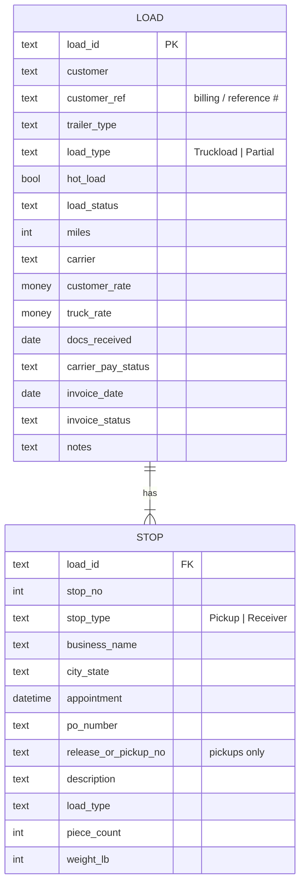
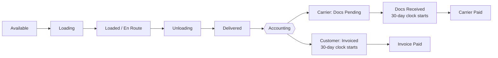

# PIFL Load Tracker

A load tracker for **Pay It Forward Logistics** ([payitforwardlogistics.com](https://payitforwardlogistics.com)), a family-owned freight brokerage in Arizona led by former CDL drivers. It follows a load from the board to the driver to the money: load status, pickup and receiver details, what we bill and what we pay, and the two 30-day pay clocks.

- **Live preview:** https://sophiamunkeboe.github.io/pifl-driver-load-tracker/
- **Excel tracker:** [`PIFL_Driver_Load_Tracker.xlsx`](PIFL_Driver_Load_Tracker.xlsx)

> Every company, number and date in the file and the preview is **made-up sample data**.

## Data model

One **load** has one pickup (shipper) and **one or more receivers**. In the spreadsheet, loads live on the `Loads` sheet and stops live on the `Stops` sheet, joined by **Load ID**.

### `Loads` sheet (one row per load)

| Column | Field | Notes |
|---|---|---|
| A | **Load ID** | Our internal load number (e.g. `PIFL-1005`). |
| B | **Customer Name** | Who we bill. |
| C | **Customer Billing / Ref #** | The number the customer uses to match our invoice. |
| D | **Trailer Type** | Dropdown: Dry Van, Reefer, Flatbed, Step Deck, Other. |
| E | **Load Type** | Dropdown: Truckload or Partial. |
| F | **Hot Load?** | Yes / No. **Yes turns the whole row red.** |
| G | **Load Status** | Dropdown, see the status flow below. |
| H | **# Receivers** | Formula: counts the receiver rows on `Stops`. |
| I | **Miles** | Trip miles. |
| J | **Carrier (Truck)** | The carrier hauling it. |
| K | **Customer Rate (we bill)** | |
| L | **Truck Rate (we pay)** | |
| M | **Margin $** | Formula: `K − L`. |
| N | **Margin %** | Formula: `(K − L) ÷ K`. |
| O | **BOL / Docs Received** | Date the signed BOL / paperwork came back from the truck. |
| P | **Carrier Pay Due** | Formula: `O + 30`. |
| Q | **Carrier Pay Status** | Dropdown: Docs Pending, Docs Received, Paid. |
| R | **Carrier Paid Date** | |
| S | **Days Left to Pay Carrier** | Formula: `P − TODAY()`, blank once Paid. |
| T | **Invoice Date** | Date we invoiced the customer. |
| U | **Customer Due** | Formula: `T + 30`. |
| V | **Customer Invoice Status** | Dropdown: Not Invoiced, Invoiced, Invoice Paid. |
| W | **Invoice Paid Date** | |
| X | **Days Left on Invoice** | Formula: `U − TODAY()`, blank once paid. |
| Y | **Notes** | Gate info, temps, straps/tarps, check-in steps. |

### `Stops` sheet (pickups and receivers)

| Field | Pickup | Receiver |
|---|---|---|
| Load ID, Stop #, Stop Type | ✔ | ✔ |
| Business Name, City/State, Date, Time | ✔ | ✔ |
| PO Number | ✔ | ✔ |
| Release / Pickup # | ✔ (optional) | – |
| Description | ✔ | ✔ |
| Load Type (Truckload / Partial) | ✔ | ✔ |
| Piece Count, Weight (lb) | ✔ | ✔ |

Add one row per receiver. A load with two drops gets one Pickup row and two Receiver rows with the same Load ID.

### `Lists` sheet

The values behind every dropdown. Each dropdown range includes spare blank rows, so you can add a value (say, a new trailer type) under its list and it shows up in the dropdown.

## Load status flow

The **Load Board** in the preview shows these five statuses as columns (stacked on a phone), with chips to show one status at a time and a trailer type filter.

## The two 30-day clocks

**Carrier pay clock (what we owe the truck).** It starts on the day the signed BOL / documents come back from the truck, not the delivery date.

- Pay Due = Docs Received + 30 days.
- Status goes Docs Pending → Docs Received → Paid.
- If Pay Due has passed and the status isn't Paid, the due date and days-left cells turn **dark red** (spreadsheet and preview).

**Customer invoice clock (what the customer owes us).** It starts on the invoice date.

- Customer Due = Invoice Date + 30 days.
- Status goes Not Invoiced → Invoiced → Invoice Paid.
- If Customer Due has passed and it isn't Invoice Paid, it turns **dark red**.

Days left uses `TODAY()`, so overdue flags update on their own each day. The spreadsheet's sample dates are fixed around Oct 31, 2026. The web preview places its sample dates relative to the day you open it, so it always shows a mix of open and overdue items.

## Interpretation notes

The spec was dictated by voice, so a few calls were made:

- "low tide" on receivers was read as **load type** (Truckload / Partial). If it was meant to be a load or delivery number, add a column on `Stops`.
- "peace count" = **piece count**. "await" = **weight**.
- **Carrier (Truck)** and the **# Receivers** count were added as helpers.
- Step Deck and Other were added to the trailer types.

## Files

| File | Purpose |
|---|---|
| `PIFL_Driver_Load_Tracker.xlsx` | The tracker: `Loads`, `Stops`, `Lists`, with dropdowns, formulas and red highlights. |
| `index.html` | Static preview (GitHub Pages): Load Board, load detail, Accounting tab, trailer filter. No backend. |
| `assets/` | Logo, shield crop and icons. Brand green `#427B2F`, silver `#AAABAE`, wordmark grey `#808182`. |
| `favicon.ico` | Favicon from the shield. |
| `README.md` | This file. |

## Next step

This is a spreadsheet plus a static preview. Nothing is saved from the web page. The natural next step is a **real app with logins and a database**:

- Drivers update status and upload the BOL photo from their phone, which starts the carrier pay clock automatically.
- Dispatch builds loads and assigns carriers.
- Accounting marks invoices and payments.
- Owners see margins and overdue alerts.
