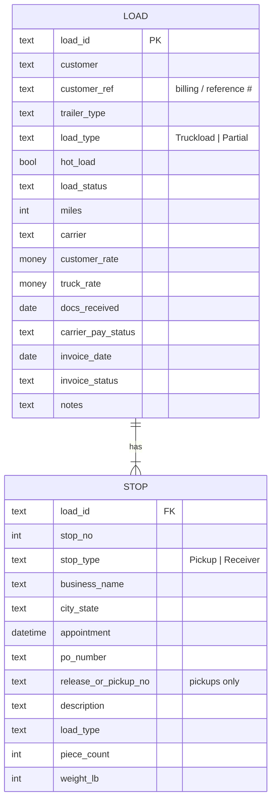
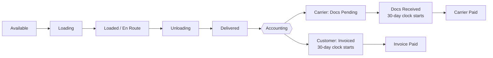

# PIFL Load Tracker

A load tracker for **Pay It Forward Logistics** ([payitforwardlogistics.com](https://payitforwardlogistics.com)), a family-owned freight brokerage in Arizona led by former CDL drivers. It follows a load from the board to the driver to the money: load status, pickup and receiver details, what we bill and what we pay, and the two 30-day pay clocks.

- **Live preview:** https://sophiamunkeboe.github.io/pifl-driver-load-tracker/
- **Excel tracker:** [`PIFL_Driver_Load_Tracker.xlsx`](PIFL_Driver_Load_Tracker.xlsx)

> Every company, number and date in the file and the preview is **made-up sample data**.

## Data model

One **load** has one pickup (shipper) and **one or more receivers**. In the spreadsheet, loads live on the `Loads` sheet and stops live on the `Stops` sheet, joined by **Load ID**.

### `Loads` sheet (one row per load)

| Column | Field | Notes |
|---|---|---|
| A | **Load ID** | Our internal load number (e.g. `PIFL-1005`). |
| B | **Customer Name** | Who we bill. |
| C | **Customer Billing / Ref #** | The number the customer uses to match our invoice. |
| D | **Trailer Type** | Dropdown: Dry Van, Reefer, Flatbed, Step Deck, Other. |
| E | **Load Type** | Dropdown: Truckload or Partial. |
| F | **Hot Load?** | Yes / No. **Yes turns the whole row red.** |
| G | **Load Status** | Dropdown, see the status flow below. |
| H | **# Receivers** | Formula: counts the receiver rows on `Stops`. |
| I | **Miles** | Trip miles. |
| J | **Carrier (Truck)** | The carrier hauling it. |
| K | **Customer Rate (we bill)** | |
| L | **Truck Rate (we pay)** | |
| M | **Margin $** | Formula: `K − L`. |
| N | **Margin %** | Formula: `(K − L) ÷ K`. |
| O | **BOL / Docs Received** | Date the signed BOL / paperwork came back from the truck. |
| P | **Carrier Pay Due** | Formula: `O + 30`. |
| Q | **Carrier Pay Status** | Dropdown: Docs Pending, Docs Received, Paid. |
| R | **Carrier Paid Date** | |
| S | **Days Left to Pay Carrier** | Formula: `P − TODAY()`, blank once Paid. |
| T | **Invoice Date** | Date we invoiced the customer. |
| U | **Customer Due** | Formula: `T + 30`. |
| V | **Customer Invoice Status** | Dropdown: Not Invoiced, Invoiced, Invoice Paid. |
| W | **Invoice Paid Date** | |
| X | **Days Left on Invoice** | Formula: `U − TODAY()`, blank once paid. |
| Y | **Notes** | Gate info, temps, straps/tarps, check-in steps. |

### `Stops` sheet (pickups and receivers)

| Field | Pickup | Receiver |
|---|---|---|
| Load ID, Stop #, Stop Type | ✔ | ✔ |
| Business Name, City/State, Date, Time | ✔ | ✔ |
| PO Number | ✔ | ✔ |
| Release / Pickup # | ✔ (optional) | – |
| Description | ✔ | ✔ |
| Load Type (Truckload / Partial) | ✔ | ✔ |
| Piece Count, Weight (lb) | ✔ | ✔ |

Add one row per receiver. A load with two drops gets one Pickup row and two Receiver rows with the same Load ID.

### `Lists` sheet

The values behind every dropdown. Each dropdown range includes spare blank rows, so you can add a value (say, a new trailer type) under its list and it shows up in the dropdown.

## Load status flow

The **Load Board** in the preview shows these five statuses as columns (stacked on a phone), with chips to show one status at a time and a trailer type filter.

## Calendar

The **Calendar** tab shows every pickup (**PU**) and drop-off (**DEL**) by day. It fills the screen and follows the trailer type filter.

- **Month view:** a full-screen month with large day squares, weekday headers and the month name up top. Each square shows big PU and DEL counts. Tap or click a day to open its list of stops, sorted by time. Tap a stop to open the load.
- **Week view:** seven tall day columns, each listing that day's pickups and drop-offs by time. On a phone the columns scroll sideways and open on today.
- **Done tracking:**
  - A pickup counts as done once its load is **Loaded / En Route** or later.
  - A drop-off counts as done once its load is **Delivered**.
  - When every stop on a day is done, the square turns light green with a **✓ Done** badge.
  - A partly done day shows progress, e.g. **1/2**.
  - A past day with unfinished stops stays white and gets a small **red dot**.
- Use the Month/Week toggle, ‹ › and Today to move around.

## Board style: Old School Chris | New Look

One switch in the header sets the look for the whole app, and the browser remembers it (`localStorage` key `pifl-look`).

- **Old School Chris** turns the Load Board into a dense table modelled on the ITS Dispatch Board.
  - Columns: Load #, W/O # (PO/BOL/unit), Driver/Carrier, Ship Date, Del Date, Customer, Origin, Destination.
  - Rows are tinted by ITS status, with a legend: Pending, Open, Refused, Covered, Dispatched, On Route, (Un)Loading, In Yard.
  - A load with no carrier shows a blue **Assign Later** link. Clicking a load # opens the load card.
  - Sort by clicking a column header (default is Ship Date ▼). The **Find** box filters the rows, and "Show delivered" adds delivered loads.
  - On a phone the table scrolls sideways.
- **New Look** is the card board (columns by status).
- In the Calendar, the day popup follows the same switch: Old School Chris shows the same table filtered to that day, and New Look shows the stop cards. The popup has its own copy of the switch.
- The day popup has an **All | Pick-ups | Deliveries** toggle with a count on each. Pick-ups are loads with a pickup that day, sorted by ship date/time. Deliveries are loads with a drop-off that day, sorted by del date/time; a multi-drop load counts on each drop day. All is the union, and in the table it adds a PU/DEL tag column. The choice is remembered (`localStorage` key `pifl-dayfilter`).
  - Until someone picks a look, a day with more than 8 loads opens as the table.
  - Closing a load card opened from the table goes back to the table.

How ITS status is derived:

| ITS status | From |
|---|---|
| Open | Available, no carrier |
| Covered | Available, carrier booked, pickup after today |
| Dispatched | Available, carrier booked, pickup today or earlier |
| (Un)Loading | Loading or Unloading |
| On Route | Loaded / En Route |
| Pending, Refused, In Yard | the optional `its` field on a load, used while the load is still in the matching status |

## Hot loads 🔥

Hot loads (`hot: Yes`) get a 🔥 next to the load number everywhere: the Old School table, New Look cards, calendar day lists, map pins, map popups and list, and the load card header. Calendar day squares show a 🔥 count of the hot loads that day. A **🔥 Hot** chip filters the New Look board, the Old School board and the map.

The small **🔥 Pulse** switch at the top right of the header turns the flame animation on or off. It is on by default and remembered (`pifl-pulse`). Flames stay still for anyone with "reduce motion" turned on.

## Map

The 🗺️ Map tab is a full-screen map of live loads.

- Each active load shows as a truck pin, colored by status and labelled with its load #. A red outline means hot.
- A dashed road line runs from pickup to delivery, with **PU** and **DEL** markers.
- Clicking a truck shows the driver, status, ETA, last update and an **Open load** button.
- Status chips filter the map (Active by default).
- The list is a sidebar on desktop and a bottom sheet on a phone. Tap the sheet header to resize it, and tap a row to fly to that truck.
- **Demo · simulated GPS:**
  - En Route trucks start where their schedule puts them and creep along the road every few seconds, with an "updated Xs ago" ping.
  - ETA = remaining miles ÷ 52 mph.
  - Driver first names are made up.
- Stops carry `lat`/`lng`. Road lines were pre-computed once from OpenStreetMap data (OSRM demo router), simplified, and embedded in the page as `ROUTES`. Nothing is called at runtime except the map tiles.
- Map: [Leaflet](https://leafletjs.com) 1.9.4 (BSD-2, in `assets/leaflet/`), tiles © [OpenStreetMap](https://www.openstreetmap.org/copyright) contributors. No API key.

## Web demo sample loads

The web demo has 16 more fictional sample loads (PIFL-1007 to PIFL-1022) on Southwest lanes, so the map, the dispatch board and a busy calendar day (tomorrow has 18 loads) have something to show. They exist only in `index.html`; the Excel tracker still has the original 6. All company names are made up. If a browser has an older saved demo, the new sample loads and coordinates are added the next time it loads.

## The two 30-day clocks

**Carrier pay clock (what we owe the truck).** It starts on the day the signed BOL / documents come back from the truck, not the delivery date.

- Pay Due = Docs Received + 30 days.
- Status goes Docs Pending → Docs Received → Paid.
- If Pay Due has passed and the status isn't Paid, the due date and days-left cells turn **dark red** (spreadsheet and preview).

**Customer invoice clock (what the customer owes us).** It starts on the invoice date.

- Customer Due = Invoice Date + 30 days.
- Status goes Not Invoiced → Invoiced → Invoice Paid.
- If Customer Due has passed and it isn't Invoice Paid, it turns **dark red**.

Days left uses `TODAY()`, so overdue flags update on their own each day. The spreadsheet's sample dates are fixed around Oct 31, 2026. The web preview places its sample dates relative to the day you open it, so it always shows a mix of open and overdue items.

## Interpretation notes

The spec was dictated by voice, so a few calls were made:

- "low tide" on receivers was read as **load type** (Truckload / Partial). If it was meant to be a load or delivery number, add a column on `Stops`.
- "peace count" = **piece count**. "await" = **weight**.
- **Carrier (Truck)** and the **# Receivers** count were added as helpers.
- Step Deck and Other were added to the trailer types.

## Files

| File | Purpose |
|---|---|
| `PIFL_Driver_Load_Tracker.xlsx` | The tracker: `Loads`, `Stops`, `Lists`, with dropdowns, formulas and red highlights. |
| `index.html` | Static preview (GitHub Pages): Load Board, full-screen Calendar (month/week), load detail, Accounting tab, trailer filter. No backend. |
| `assets/` | Logo, shield crop and icons. Brand green `#427B2F`, silver `#AAABAE`, wordmark grey `#808182`. |
| `favicon.ico` | Favicon from the shield. |
| `README.md` | This file. |

## Next step

This is a spreadsheet plus a static preview. Nothing is saved from the web page. The natural next step is a **real app with logins and a database**:

- Drivers update status and upload the BOL photo from their phone, which starts the carrier pay clock automatically.
- Dispatch builds loads and assigns carriers.
- Accounting marks invoices and payments.
- Owners see margins and overdue alerts.
